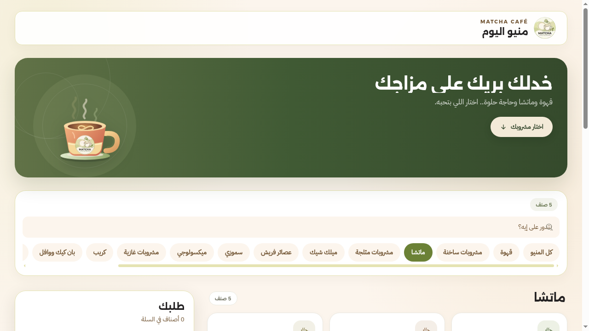
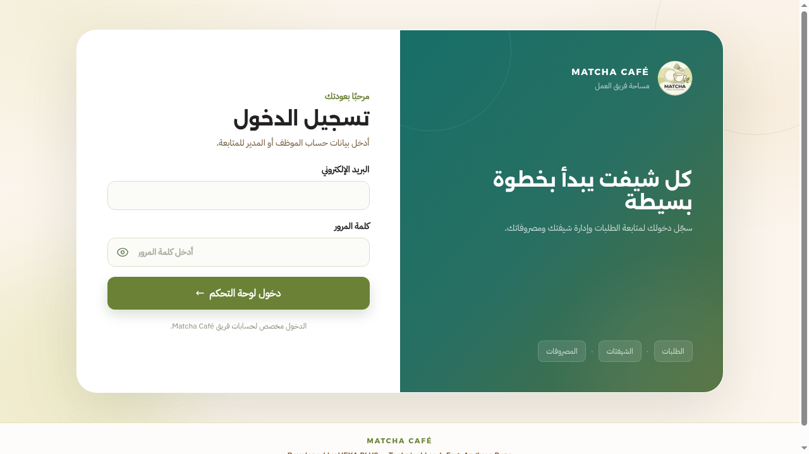

# Matcha Café — Ordering & Operations UI/UX

An Arabic-first, right-to-left café ordering and operations system designed and built by **Angelo Rezq**. This repository showcases the front-end of the live Matcha Café platform: a customer-facing ordering experience and a full staff dashboard.


## What's inside

- **Customer ordering** — responsive Arabic menu with search, categories, item customizations, and a cart that supports dine-in, takeaway, and delivery.
- **Cashier dashboard** — order intake, preparation status, and receipt printing for the counter.
- **Operations suite** — shifts, expenses, inventory with recipe-level stock deductions, purchase invoices, debts, payroll, and a financial overview.
- **Reports** — per-shift sales and expense reports with Excel exports across every module.

## Highlights

- Full RTL layout built Arabic-first, not mirrored as an afterthought: type scale, spacing, and icon placement all follow the reading direction.
- A component per operational workflow (cashier, inventory, payroll, recipes, debts), sharing one design language.
- Live brand system: the café's colors, logo, and typography (IBM Plex Sans Arabic, Readex Pro, Alexandria) carried consistently through every screen.
- Loading, empty, and error states designed for each workflow, including a branded splash screen.

## Tech

| Layer | Choice |
|---|---|
| Framework | Next.js 16 (App Router), React 18 |
| Language | TypeScript |
| Styling | Tailwind CSS 3 |
| Forms & validation | React Hook Form + Zod |
| Exports | ExcelJS |

## Repository layout

```
app/            App Router pages (customer menu + dashboard routes)
components/     One component per workflow (cashier, inventory, payroll, ...)
```

## Screenshots

| Customer menu | Staff sign-in |
|---|---|
|  |  |

## Live

The production system runs at [matcha-cafe-two.vercel.app](https://matcha-cafe-two.vercel.app).

## Author

**Angelo Rezq** — design and front-end implementation.
